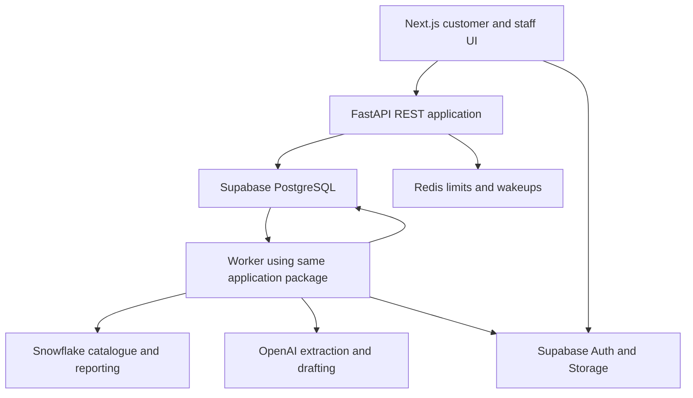

# Application architecture

> **SUPERSEDED (2026-10) — see `docs/adr/0001-langgraph-workflow-engine.md` (repo root).**
> The owner has adopted **LangGraph with deterministic routing** as the single authoritative
> workflow engine: fixed transitions are decided in code (`partsiq.workflow.transitions.next_step`),
> there is **no LLM supervisor**, and compatibility/verification/approval stay deterministic.
> Any statement in this document that forbids or excludes LangGraph is OBSOLETE. The
> consolidated engine lives in `apps/api/partsiq/workflow` and is proven by
> `apps/api/tests/test_workflow_langgraph.py` + `test_journey_e2e.py`.

## 1 What is in the system

The browser runs a Next.js application hosted on Vercel. It authenticates through Supabase and sends business REST requests to a single FastAPI backend behind Caddy. Supabase PostgreSQL stores transactional application state and a validated relational catalogue cache; Supabase Storage holds private attachments, evidence, imports and exports. A worker imports the same Python package as the API and executes durable jobs. Redis provides request-rate counters and optional wakeups. Snowflake stores immutable catalogue source versions, inventory snapshots and redacted analytical events. OpenAI performs bounded language/vision calls. BGE-M3 is an optional worker-local search capability.

## 2 Who owns each responsibility

| Module | Exact application directory | Responsibility |
|---|---|---|
| Transport | apps/api/partsiq/api | Typed REST endpoints, error serialization and dependency injection |
| Authentication | apps/api/partsiq/auth | JWT verification, scope, roles and demo sessions |
| Enquiries | apps/api/partsiq/enquiries | Intake, history, corrections, fulfilment, review and publication |
| Search | apps/api/partsiq/search | Legacy identification, compatibility, lexical ranking and optional embeddings |
| Workflow | apps/api/partsiq/workflow | Fixed transitions and persisted step results |
| AI | apps/api/partsiq/ai | Allowance-controlled structured extraction, vision and reply slots |
| Jobs | apps/api/partsiq/jobs | Claims, leases, dispatch, retry and cleanup |
| Catalogue | apps/api/partsiq/catalogue | Snowflake source, validation and atomic serving activation |
| Analytics | apps/api/partsiq/analytics | Redacted outbox, Snowflake export and scoped metrics |
| Storage and exports | apps/api/partsiq/storage and exports | Private signed transfers and approved PDFs |
| Features | apps/api/partsiq/features | User-case facades; no duplicated domain safety rules |
| Web | apps/web/src | Accessible bilingual pages, panels and typed API client |

## 3 Why this structure

The customer journey has a known sequence. Ordinary functions and a fixed state table are sufficient; an LLM does not need to decide which component runs next. One backend avoids multiple internal HTTP hops and duplicated deployment configuration. Background work remains separate because photo reading, imports and PDF rendering can outlive an HTTP request. Snowflake gives the project a real data ingestion/reporting boundary, while the relational serving cache preserves transactional integrity and low-cost interactive access.

## 4 What each layer may access

Routes call feature facades and inject a verified ActorContext. Facades invoke domain functions and repositories. Domain search never calls an LLM to decide compatibility. AI modules receive minimal data and return typed results; they have no database write tools. Only the approval service can create recommendation messages. Catalogue synchronization uses a dedicated publisher role; ordinary API routes cannot update published fitment rows. Snowflake connectors execute allowlisted SQL with bound values and task-scoped connections. Frontend has no Snowflake or database-owner credential.

## 5 Who owns the data

PostgreSQL is authoritative for identity linkage, enquiries, revisions, candidates, drafts, decisions, jobs, budgets, audit and the active catalogue pointer. Snowflake holds the immutable source records for catalogue versions and analytical copies. Activation copies a verified source snapshot into PostgreSQL under a single transaction; that serving copy is authoritative for a particular active version until another validated version is activated. This is an explicit replicated-data contract, not two writable masters. Stock is separately timestamped and never treated as a reservation.

## 6 Where asynchronous boundaries exist

An API mutation commits the business record and durable job together. The worker claims the job and performs external work outside database locks. It commits only if lease token, revision and demo generation still match. Redis loss does not delete jobs. Snowflake publication is a recoverable two-system process: remote immutable upload first, local validation and activation second. Analytics uses an outbox with idempotent EVENT_ID MERGE and acknowledgement after remote success. No distributed transaction is claimed.

## 7 How security and failures are contained

Every scoped route checks identity and ownership/assignment. PostgreSQL RLS provides another boundary. Background handlers load trusted job context and fence final writes. Private files require signed access after authorization. Provider errors never bypass compatibility or approval. Wrong/expired allowance blocks live AI; Snowflake outage leaves an explicitly identified last validated snapshot usable only within freshness policy. A new unpublished version cannot replace a working snapshot. If required data is too stale, the workflow pauses.

## 8 How this is tested and operated

Unit tests cover pure rules; integration tests cover real PostgreSQL constraints, RLS, idempotency and concurrency; feature tests cover all 69 behaviors; browser tests cover both languages and four demos. Live Snowflake and provider checks require separate account receipts. API and worker share one immutable image, with Caddy and Redis on one EC2 host where confirmed credits permit. Supabase dev/prod are separate projects. The host is a single point of failure; backups and recovery are documented without a high-availability claim. Fixture mode remains a clearly labelled local demonstration path.
