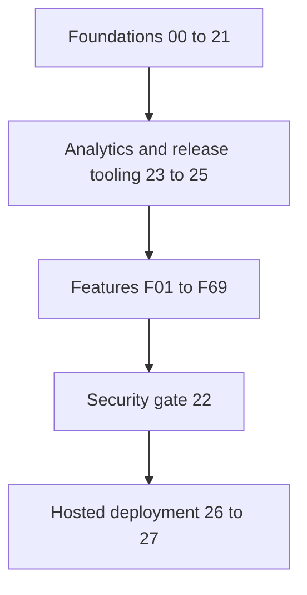

# Build order

Execute one prompt at a time in this order. Numeric filename order is not execution order. Foundations00–21 and23–25 create shared functionality and release tooling; F01–F69 implement the entire product; 22 and26–27 run final gates and deployment.

| Order | Prompt | Purpose |
|---|---|---|
| 1 | [00](00-bootstrap.md) | Repository bootstrap and legacy characterization |
| 2 | [01](01-core.md) | Typed contracts and application configuration |
| 3 | [02](02-snowflake.md) | Snowflake connector and validated catalogue source |
| 4 | [03](03-database.md) | Supabase schema permissions and serving cache |
| 5 | [04](04-storage.md) | Private uploads evidence and storage access |
| 6 | [05](05-fixtures.md) | Synthetic catalogue and four scenario fixtures |
| 7 | [06](06-search.md) | Compatibility lexical matching and optional embeddings |
| 8 | [07](07-auth.md) | Authentication ownership and demo isolation |
| 9 | [08](08-intake.md) | Enquiry intake idempotency and rate limiting |
| 10 | [09](09-workflow.md) | Plain Python durable workflow |
| 11 | [10](10-extraction.md) | OpenAI extraction and usage allowance |
| 12 | [11](11-resolution.md) | Machine search and fulfilment application flow |
| 13 | [12](12-verification.md) | Deterministic verification and fact hashing |
| 14 | [13](13-drafts.md) | Bilingual reply slots and safe rendering |
| 15 | [14](14-approval.md) | Review transactions revisions and publication |
| 16 | [15](15-jobs.md) | Durable worker leases retries and cleanup |
| 17 | [16](16-vision.md) | Nameplate reading and human confirmation |
| 18 | [17](17-exports.md) | Approved bilingual PDF export |
| 19 | [18](18-web.md) | Next.js shell branding authentication and API client |
| 20 | [19](19-customer_web.md) | Customer pages and demo integration shell |
| 21 | [20](20-staff_web.md) | Staff pages and authorized review shell |
| 22 | [21](21-evaluation.md) | Deterministic evaluation and evidence receipts |
| 23 | [23](23-analytics.md) | Structured logs tracing metrics and Snowflake outbox |
| 24 | [24](24-containers.md) | One application image worker and Caddy |
| 25 | [25](25-ci.md) | CI reproducible builds and release checks |
| 26 | [F01](F01-branded-landing.md) | Branded landing |
| 27 | [F02](F02-demo-scenarios-and-assets.md) | Demo scenarios and assets |
| 28 | [F03](F03-demo-role-switching.md) | Demo role switching |
| 29 | [F04](F04-demo-isolation.md) | Demo isolation |
| 30 | [F05](F05-demo-reset.md) | Demo reset |
| 31 | [F06](F06-responsive-layouts.md) | Responsive layouts |
| 32 | [F07](F07-arabic-and-english-interface.md) | Arabic and English interface |
| 33 | [F08](F08-light-and-dark-themes.md) | Light and dark themes |
| 34 | [F09](F09-bilingual-chat.md) | Bilingual chat |
| 35 | [F10](F10-structured-extraction.md) | Structured extraction |
| 36 | [F11](F11-clarifying-questions.md) | Clarifying questions |
| 37 | [F12](F12-conversation-memory.md) | Conversation memory |
| 38 | [F13](F13-private-uploads.md) | Private uploads |
| 39 | [F14](F14-nameplate-ocr.md) | Nameplate OCR |
| 40 | [F15](F15-ocr-confirmation.md) | OCR confirmation |
| 41 | [F16](F16-photo-quality-feedback.md) | Photo quality feedback |
| 42 | [F17](F17-multi-part-enquiries.md) | Multi-part enquiries |
| 43 | [F18](F18-progress-timeline.md) | Progress timeline |
| 44 | [F19](F19-enquiry-history.md) | Enquiry history |
| 45 | [F20](F20-machine-identification.md) | Machine identification |
| 46 | [F21](F21-machine-mismatch-detection.md) | Machine mismatch detection |
| 47 | [F22](F22-compatibility-gate.md) | Compatibility gate |
| 48 | [F23](F23-aliases-and-typo-matching.md) | Aliases and typo matching |
| 49 | [F24](F24-semantic-retrieval.md) | Semantic retrieval |
| 50 | [F25](F25-ranked-candidates.md) | Ranked candidates |
| 51 | [F26](F26-ambiguity-handling.md) | Ambiguity handling |
| 52 | [F27](F27-match-explanations.md) | Match explanations |
| 53 | [F28](F28-compatibility-references.md) | Compatibility references |
| 54 | [F29](F29-evidence-page-viewer.md) | Evidence page viewer |
| 55 | [F30](F30-old-part-numbers.md) | Old part numbers |
| 56 | [F31](F31-candidate-comparison.md) | Candidate comparison |
| 57 | [F32](F32-warehouse-stock.md) | Warehouse stock |
| 58 | [F33](F33-fulfilment-planning.md) | Fulfilment planning |
| 59 | [F34](F34-transfer-estimates.md) | Transfer estimates |
| 60 | [F35](F35-stock-freshness.md) | Stock freshness |
| 61 | [F36](F36-staff-inbox.md) | Staff inbox |
| 62 | [F37](F37-review-workspace.md) | Review workspace |
| 63 | [F38](F38-correct-extracted-details.md) | Correct extracted details |
| 64 | [F39](F39-review-actions.md) | Review actions |
| 65 | [F40](F40-approval-invalidation.md) | Approval invalidation |
| 66 | [F41](F41-internal-notes.md) | Internal notes |
| 67 | [F42](F42-assignments.md) | Assignments |
| 68 | [F43](F43-overdue-indicators.md) | Overdue indicators |
| 69 | [F44](F44-conversation-summary.md) | Conversation summary |
| 70 | [F45](F45-reply-drafting.md) | Reply drafting |
| 71 | [F46](F46-verification-gate.md) | Verification gate |
| 72 | [F47](F47-human-publication-gate.md) | Human publication gate |
| 73 | [F48](F48-input-isolation.md) | Input isolation |
| 74 | [F49](F49-audit-trail.md) | Audit trail |
| 75 | [F50](F50-durable-workflows.md) | Durable workflows |
| 76 | [F51](F51-background-jobs.md) | Background jobs |
| 77 | [F52](F52-retry-and-deduplication.md) | Retry and deduplication |
| 78 | [F53](F53-graceful-failures.md) | Graceful failures |
| 79 | [F54](F54-access-and-permissions.md) | Access and permissions |
| 80 | [F55](F55-saved-machines.md) | Saved machines |
| 81 | [F56](F56-repeat-enquiry.md) | Repeat enquiry |
| 82 | [F57](F57-catalogue-browser.md) | Catalogue browser |
| 83 | [F58](F58-catalogue-imports.md) | Catalogue imports |
| 84 | [F59](F59-catalogue-versioning.md) | Catalogue versioning |
| 85 | [F60](F60-missing-parts-queue.md) | Missing-parts queue |
| 86 | [F61](F61-enquiry-pdf.md) | Enquiry PDF |
| 87 | [F62](F62-labelled-evaluations.md) | Labelled evaluations |
| 88 | [F63](F63-metrics-dashboard.md) | Metrics dashboard |
| 89 | [F64](F64-latency-and-ai-cost.md) | Latency and AI cost |
| 90 | [F65](F65-correction-feedback.md) | Correction feedback |
| 91 | [F66](F66-tests-and-ci.md) | Tests and CI |
| 92 | [F67](F67-traces.md) | Traces |
| 93 | [F68](F68-recruiter-documentation.md) | Recruiter documentation |
| 94 | [F69](F69-demo-walkthrough.md) | Demo walkthrough |
| 95 | [22](22-security.md) | Security concurrency and failure recovery acceptance |
| 96 | [26](26-deployment.md) | AWS and Snowflake account setup and deployment |
| 97 | [27](27-hosted.md) | Vercel configuration and complete hosted walkthrough |

