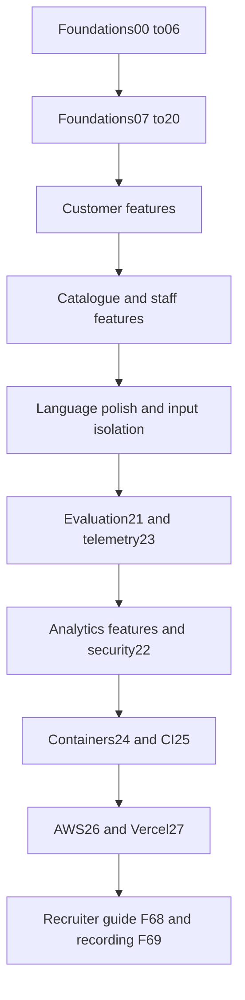

# Execution order

Execute implementation prompts in this table,not alphabetical F order. After a foundation,run its covered F verification prompts. They introduce no additional runtime dependencies. Every feature has a trace and test mapping in spec/features.json.

| Order | Prompt | Task | Dependencies |
|---|---|---|---|
| 1 | [00](00-bootstrap-and-preserve-legacy.md) | Bootstrap and preserve legacy | none |
| 2 | [01](01-shared-contracts-and-clients.md) | Shared contracts and clients | 00 |
| 3 | [02](02-catalogue-migration.md) | Catalogue migration | 01 |
| 4 | [03](03-workflow-schema-and-database-permissions.md) | Workflow schema and database permissions | 02 |
| 5 | [04](04-private-storage.md) | Private storage | 03 |
| 6 | [05](05-synthetic-catalogue-and-demo-fixtures.md) | Synthetic catalogue and demo fixtures | 04 |
| 7 | [06](06-extend-legacy-search.md) | Extend legacy search | 05 |
| 8 | [07](07-authentication-and-demo-sessions.md) | Authentication and demo sessions | 06 |
| 9 | [08](08-enquiry-intake-and-limits.md) | Enquiry intake and limits | 07 |
| 10 | [09](09-deterministic-durable-workflow.md) | Deterministic durable workflow | 08 |
| 11 | [10](10-intake-specialist.md) | Intake specialist | 09 |
| 12 | [11](11-parts-specialist-and-tools.md) | Parts specialist and tools | 10 |
| 13 | [12](12-deterministic-verification.md) | Deterministic verification | 11 |
| 14 | [13](13-reply-specialist-and-renderer.md) | Reply specialist and renderer | 12 |
| 15 | [14](14-approval-and-revision-transactions.md) | Approval and revision transactions | 13 |
| 16 | [15](15-worker-leases-and-sweeper.md) | Worker leases and sweeper | 14 |
| 17 | [16](16-nameplate-vision-job.md) | Nameplate vision job | 15 |
| 18 | [17](17-approved-enquiry-pdf.md) | Approved enquiry PDF | 16 |
| 19 | [18](18-frontend-shell-and-authentication.md) | Frontend shell and authentication | 17 |
| 20 | [19](19-customer-chat-and-demo.md) | Customer chat and demo | 18 |
| 21 | [20](20-staff-workspace-and-timeline.md) | Staff workspace and timeline | 19 |
| 22 | [F16](F16-photo-quality-feedback.md) | Photo quality feedback | 16, 19 |
| 23 | [F17](F17-multi-part-enquiries.md) | Multi-part enquiries | 09, 10, 11, 12, 13, 14, 19, 20 |
| 24 | [F19](F19-enquiry-history.md) | Enquiry history | 07, 08, 19 |
| 25 | [F55](F55-saved-machines.md) | Saved machines | 07, 19 |
| 26 | [F56](F56-repeat-enquiry.md) | Repeat enquiry | 09, 19, F19, F55 |
| 27 | [F59](F59-catalogue-versioning.md) | Catalogue versioning | 02, 05, 06 |
| 28 | [F57](F57-catalogue-browser.md) | Catalogue browser | 02, 06, 18, F59 |
| 29 | [F58](F58-catalogue-imports.md) | Catalogue imports | 02, 05, 15, F59, F57 |
| 30 | [F60](F60-missing-parts-queue.md) | Missing-parts queue | 03, 20 |
| 31 | [F35](F35-stock-freshness.md) | Stock freshness | 06, 12, 14, 20 |
| 32 | [F29](F29-evidence-page-viewer.md) | Evidence page viewer | 04, 06, 20 |
| 33 | [F31](F31-candidate-comparison.md) | Candidate comparison | 06, 20 |
| 34 | [F38](F38-correct-extracted-details.md) | Correct extracted details | 09, 14, 20 |
| 35 | [F42](F42-assignments.md) | Assignments | 03, 07, 20 |
| 36 | [F41](F41-internal-notes.md) | Internal notes | 03, 07, 20 |
| 37 | [F43](F43-overdue-indicators.md) | Overdue indicators | 20 |
| 38 | [F44](F44-conversation-summary.md) | Conversation summary | 09, 13, 20 |
| 39 | [F36](F36-staff-inbox.md) | Staff inbox | 07, 20, F42, F43 |
| 40 | [F07](F07-arabic-and-english-interface.md) | Arabic and English interface | 18, 19, 20 |
| 41 | [F08](F08-light-and-dark-themes.md) | Light and dark themes | 18 |
| 42 | [F06](F06-responsive-layouts.md) | Responsive layouts | 18, 19, 20, F07, F08 |
| 43 | [F48](F48-input-isolation.md) | Input isolation | 10, 11, 12, 13, 16 |
| 44 | [21](21-labelled-evaluations.md) | Labelled evaluations | F48 |
| 45 | [23](23-observability-and-credit-limits.md) | Observability and credit limits | 21 |
| 46 | [F63](F63-metrics-dashboard.md) | Metrics dashboard | 21, 23 |
| 47 | [F65](F65-correction-feedback.md) | Correction feedback | 14, 21, 23, F63 |
| 48 | [22](22-security-and-failure-recovery-gate.md) | Security and failure recovery gate | F65 |
| 49 | [24](24-production-containers-and-caddy.md) | Production containers and Caddy | 22 |
| 50 | [25](25-ci-and-controlled-deployment.md) | CI and controlled deployment | 24 |
| 51 | [26](26-aws-free-plan-deployment.md) | AWS free-plan deployment | 25 |
| 52 | [27](27-vercel-and-hosted-acceptance.md) | Vercel and hosted acceptance | 26 |
| 53 | [F68](F68-recruiter-documentation.md) | Recruiter documentation | 21, 23, 22, 24, 25, 26, 27 |
| 54 | [F69](F69-demo-walkthrough.md) | Demo walkthrough | 27, F68 |

## Dependency diagram

## Feature coverage
| Feature | Implementation owner | Feature prompt | Test |
|---|---|---|---|
| F01 Branded landing | 18 | [F01](F01-branded-landing.md) | `apps/web/tests/features/f01.test.tsx` |
| F02 Demo scenarios and assets | 19 | [F02](F02-demo-scenarios-and-assets.md) | `tests/acceptance/test_f02.py` |
| F03 Demo role switching | 20 | [F03](F03-demo-role-switching.md) | `services/gateway/tests/features/test_f03.py` |
| F04 Demo isolation | 22 | [F04](F04-demo-isolation.md) | `services/gateway/tests/features/test_f04.py` |
| F05 Demo reset | 19 | [F05](F05-demo-reset.md) | `services/gateway/tests/features/test_f05.py` |
| F06 Responsive layouts | F06 | [F06](F06-responsive-layouts.md) | `apps/web/tests/features/f06.test.tsx` |
| F07 Arabic and English interface | F07 | [F07](F07-arabic-and-english-interface.md) | `apps/web/tests/features/f07.test.tsx` |
| F08 Light and dark themes | F08 | [F08](F08-light-and-dark-themes.md) | `apps/web/tests/features/f08.test.tsx` |
| F09 Bilingual chat | 19 | [F09](F09-bilingual-chat.md) | `services/orchestrator/tests/features/test_f09.py` |
| F10 Structured extraction | 10 | [F10](F10-structured-extraction.md) | `services/orchestrator/tests/features/test_f10.py` |
| F11 Clarifying questions | 19 | [F11](F11-clarifying-questions.md) | `services/orchestrator/tests/features/test_f11.py` |
| F12 Conversation memory | 09 | [F12](F12-conversation-memory.md) | `services/orchestrator/tests/features/test_f12.py` |
| F13 Private uploads | 19 | [F13](F13-private-uploads.md) | `services/gateway/tests/features/test_f13.py` |
| F14 Nameplate OCR | 16 | [F14](F14-nameplate-ocr.md) | `services/worker/tests/features/test_f14.py` |
| F15 OCR confirmation | 19 | [F15](F15-ocr-confirmation.md) | `apps/web/tests/features/f15.test.tsx` |
| F16 Photo quality feedback | F16 | [F16](F16-photo-quality-feedback.md) | `services/worker/tests/features/test_f16.py` |
| F17 Multi-part enquiries | F17 | [F17](F17-multi-part-enquiries.md) | `services/orchestrator/tests/features/test_f17.py` |
| F18 Progress timeline | 20 | [F18](F18-progress-timeline.md) | `apps/web/tests/features/f18.test.tsx` |
| F19 Enquiry history | F19 | [F19](F19-enquiry-history.md) | `services/gateway/tests/features/test_f19.py` |
| F20 Machine identification | 06 | [F20](F20-machine-identification.md) | `services/search/tests/features/test_f20.py` |
| F21 Machine mismatch detection | 06 | [F21](F21-machine-mismatch-detection.md) | `services/search/tests/features/test_f21.py` |
| F22 Compatibility gate | 06 | [F22](F22-compatibility-gate.md) | `services/search/tests/features/test_f22.py` |
| F23 Aliases and typo matching | 06 | [F23](F23-aliases-and-typo-matching.md) | `services/search/tests/features/test_f23.py` |
| F24 Semantic retrieval | 06 | [F24](F24-semantic-retrieval.md) | `services/search/tests/features/test_f24.py` |
| F25 Ranked candidates | 06 | [F25](F25-ranked-candidates.md) | `services/search/tests/features/test_f25.py` |
| F26 Ambiguity handling | 11 | [F26](F26-ambiguity-handling.md) | `services/orchestrator/tests/features/test_f26.py` |
| F27 Match explanations | 20 | [F27](F27-match-explanations.md) | `apps/web/tests/features/f27.test.tsx` |
| F28 Compatibility references | 12 | [F28](F28-compatibility-references.md) | `services/search/tests/features/test_f28.py` |
| F29 Evidence page viewer | F29 | [F29](F29-evidence-page-viewer.md) | `services/gateway/tests/features/test_f29.py` |
| F30 Old part numbers | 06 | [F30](F30-old-part-numbers.md) | `services/search/tests/features/test_f30.py` |
| F31 Candidate comparison | F31 | [F31](F31-candidate-comparison.md) | `apps/web/tests/features/f31.test.tsx` |
| F32 Warehouse stock | 20 | [F32](F32-warehouse-stock.md) | `services/search/tests/features/test_f32.py` |
| F33 Fulfilment planning | 06 | [F33](F33-fulfilment-planning.md) | `services/search/tests/features/test_f33.py` |
| F34 Transfer estimates | 06 | [F34](F34-transfer-estimates.md) | `services/search/tests/features/test_f34.py` |
| F35 Stock freshness | F35 | [F35](F35-stock-freshness.md) | `services/search/tests/features/test_f35.py` |
| F36 Staff inbox | F36 | [F36](F36-staff-inbox.md) | `services/gateway/tests/features/test_f36.py` |
| F37 Review workspace | 20 | [F37](F37-review-workspace.md) | `apps/web/tests/features/f37.test.tsx` |
| F38 Correct extracted details | F38 | [F38](F38-correct-extracted-details.md) | `services/orchestrator/tests/features/test_f38.py` |
| F39 Review actions | 20 | [F39](F39-review-actions.md) | `services/orchestrator/tests/features/test_f39.py` |
| F40 Approval invalidation | 14 | [F40](F40-approval-invalidation.md) | `services/orchestrator/tests/features/test_f40.py` |
| F41 Internal notes | F41 | [F41](F41-internal-notes.md) | `services/gateway/tests/features/test_f41.py` |
| F42 Assignments | F42 | [F42](F42-assignments.md) | `services/gateway/tests/features/test_f42.py` |
| F43 Overdue indicators | F43 | [F43](F43-overdue-indicators.md) | `services/gateway/tests/features/test_f43.py` |
| F44 Conversation summary | F44 | [F44](F44-conversation-summary.md) | `services/orchestrator/tests/features/test_f44.py` |
| F45 Reply drafting | 13 | [F45](F45-reply-drafting.md) | `services/orchestrator/tests/features/test_f45.py` |
| F46 Verification gate | 12 | [F46](F46-verification-gate.md) | `services/orchestrator/tests/features/test_f46.py` |
| F47 Human publication gate | 14 | [F47](F47-human-publication-gate.md) | `services/orchestrator/tests/features/test_f47.py` |
| F48 Input isolation | F48 | [F48](F48-input-isolation.md) | `services/orchestrator/tests/features/test_f48.py` |
| F49 Audit trail | 14 | [F49](F49-audit-trail.md) | `tests/acceptance/test_f49.py` |
| F50 Durable workflows | 09 | [F50](F50-durable-workflows.md) | `services/orchestrator/tests/features/test_f50.py` |
| F51 Background jobs | 15 | [F51](F51-background-jobs.md) | `services/worker/tests/features/test_f51.py` |
| F52 Retry and deduplication | 15 | [F52](F52-retry-and-deduplication.md) | `services/worker/tests/features/test_f52.py` |
| F53 Graceful failures | 22 | [F53](F53-graceful-failures.md) | `apps/web/tests/features/f53.test.tsx` |
| F54 Access and permissions | 22 | [F54](F54-access-and-permissions.md) | `services/gateway/tests/features/test_f54.py` |
| F55 Saved machines | F55 | [F55](F55-saved-machines.md) | `services/gateway/tests/features/test_f55.py` |
| F56 Repeat enquiry | F56 | [F56](F56-repeat-enquiry.md) | `services/gateway/tests/features/test_f56.py` |
| F57 Catalogue browser | F57 | [F57](F57-catalogue-browser.md) | `services/gateway/tests/features/test_f57.py` |
| F58 Catalogue imports | F58 | [F58](F58-catalogue-imports.md) | `services/worker/tests/features/test_f58.py` |
| F59 Catalogue versioning | F59 | [F59](F59-catalogue-versioning.md) | `tests/acceptance/test_f59.py` |
| F60 Missing-parts queue | F60 | [F60](F60-missing-parts-queue.md) | `services/gateway/tests/features/test_f60.py` |
| F61 Enquiry PDF | 20 | [F61](F61-enquiry-pdf.md) | `services/worker/tests/features/test_f61.py` |
| F62 Labelled evaluations | 21 | [F62](F62-labelled-evaluations.md) | `tests/acceptance/test_f62.py` |
| F63 Metrics dashboard | F63 | [F63](F63-metrics-dashboard.md) | `services/gateway/tests/features/test_f63.py` |
| F64 Latency and AI cost | 23 | [F64](F64-latency-and-ai-cost.md) | `tests/acceptance/test_f64.py` |
| F65 Correction feedback | F65 | [F65](F65-correction-feedback.md) | `services/gateway/tests/features/test_f65.py` |
| F66 Tests and CI | 25 | [F66](F66-tests-and-ci.md) | `tests/acceptance/test_f66.py` |
| F67 Traces | 23 | [F67](F67-traces.md) | `tests/acceptance/test_f67.py` |
| F68 Recruiter documentation | F68 | [F68](F68-recruiter-documentation.md) | `tests/acceptance/test_f68.py` |
| F69 Demo walkthrough | F69 | [F69](F69-demo-walkthrough.md) | `tests/acceptance/test_f69.py` |
